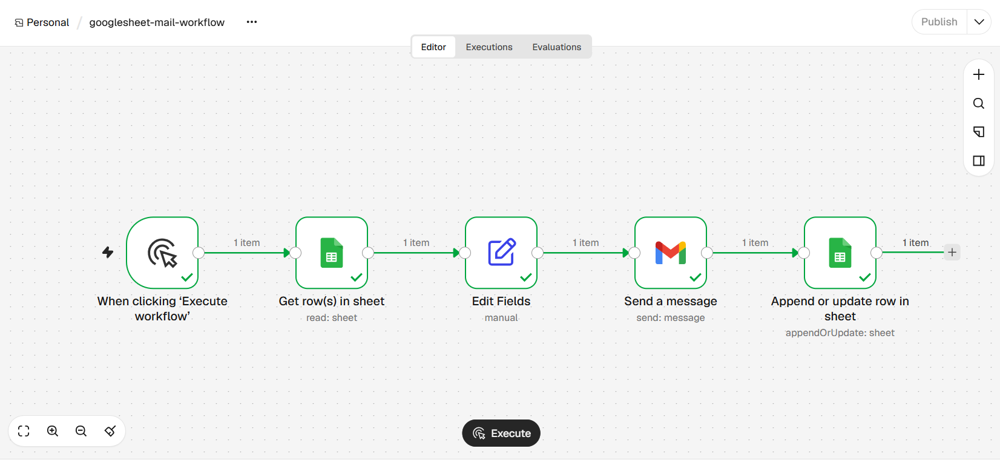
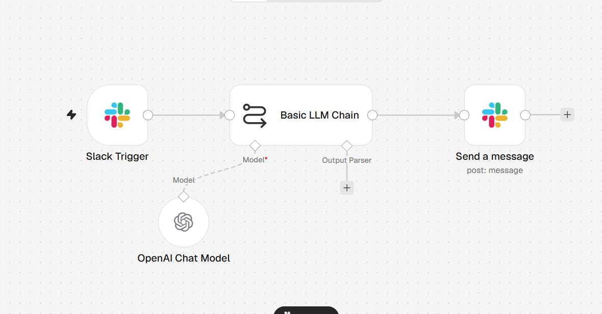
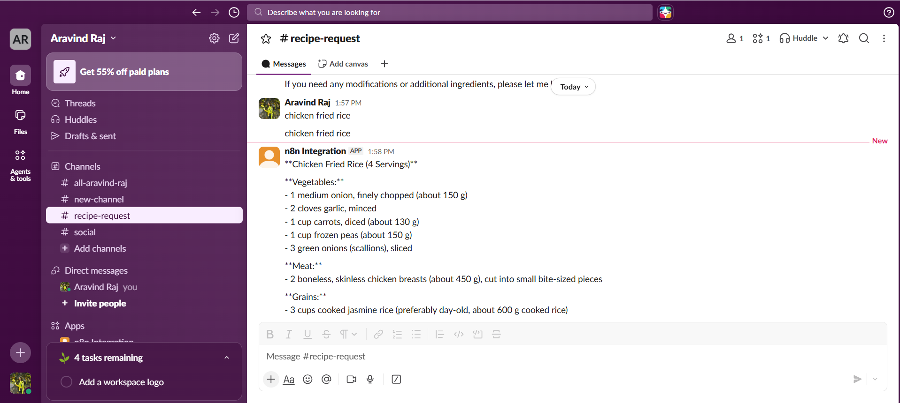

# n8n Slack and Gmail Automation

This project contains two independent n8n workflows. Set up either workflow on its own or import both into the same n8n instance.

| Workflow | Trigger | Result |
| --- | --- | --- |
| [Google Sheets → Gmail](googlesheet-mail-workflow.json) | Manual execution in n8n | Sends a personalized email for each row read from Google Sheets, then writes `Completed` back to the matching row. |
| [Slack Recipe AI Assistant](Slack%20Recipe%20AI%20Assistant.json) | A new message in the configured Slack channel | Uses OpenAI to produce a categorized ingredient list for four servings and posts it to Slack. |

## 1. Prepare n8n and import the workflows

1. Sign in to an existing n8n instance, start an n8n Cloud instance, or install a current self-hosted release using Docker or npm. For the Slack workflow, Slack must be able to reach the trigger over public HTTPS. If you self-host behind a reverse proxy, configure n8n's public webhook URL and confirm that the trigger displays the public address. [n8n hosting options](https://docs.n8n.io/deploy/host-n8n.md) · [Reverse proxy configuration](https://docs.n8n.io/deploy/host-n8n/configure-n8n/basic-configuration/configuration-examples/configure-webhook-urls-with-reverse-proxy.md)
2. Download the workflow JSON files from the table above or use your local copy of the project.
3. In n8n, create a workflow, open the editor's three-dot menu, and choose **Import from File**. Select one JSON file. Repeat in a separate workflow for the second file. [n8n import instructions](https://docs.n8n.io/build/manage-workflows/export-and-import.md)
4. Keep the Slack workflow unpublished or inactive while configuring it. The Slack export records the original workflow as active. Replace the imported credential references, spreadsheet and tab selections, and Slack channel selections with your own values before running either workflow. Store credentials in n8n.

## 2. Set up Google Sheets → Gmail

### Prepare the spreadsheet

1. Create a Google spreadsheet and a worksheet tab for testing. Give the Google account you will connect to n8n **Editor** access.
2. Put the headers below in row 1 and add one data row. Replace the example email with an inbox you control.

   | ID | Name | Email | Subject | Status |
   | --- | --- | --- | --- | --- |
   | 1 | Alex | alex@example.com | | |

   `Name` personalizes the email and `Email` supplies the recipient and row match key. `Status` receives `Completed`. `ID` and `Subject` are present in the exported sheet schema. The workflow builds the email subject from `Name`. Use a unique, non-empty email address for each row so the update can identify its target.

### Connect Google Sheets and Gmail

1. Create a **Google Sheets OAuth2 API** credential for the two Google Sheets nodes and a **Gmail OAuth2 API** credential for the Gmail node. The Gmail account you authorize is the sender.
2. On **n8n Cloud**, use **Sign in with Google** for each credential if managed OAuth2 is available. Select the intended account and approve access.
3. On **self-hosted n8n**, or if you choose **Custom OAuth2** on Cloud, complete these steps.

   1. In Google Cloud Console, create or select a project. In **APIs & Services → Library**, enable **Google Sheets API**, **Google Drive API**, and **Gmail API**.
   2. In **Google Auth Platform**, configure the consent screen with the app name, support email, contact email, and audience. For an **External** app in **Testing**, add the Google accounts you will connect under **Audience → Test users**.
   3. In **Clients**, create an OAuth client of type **Web application**. Under **Authorized redirect URIs**, add the **OAuth Redirect URL** shown by the n8n credential. If the two credentials show different callback URLs, register both exactly as displayed.
   4. Enter the Google **Client ID** and **Client Secret** in the n8n credentials. Use **Sign in with Google** to authorize and save each credential.

   [n8n Google OAuth2 setup and troubleshooting](https://docs.n8n.io/integrations/builtin/credentials/google/oauth-single-service)

### Configure the nodes

The execution order is **Manual Trigger → Get row(s) in sheet → Edit Fields → Send a message → Append or update row in sheet**.

| Node | Configuration |
| --- | --- |
| **Get row(s) in sheet** | Select your Google Sheets credential, spreadsheet, and test tab. Use **Get Row(s)**. The export has no row filter. |
| **Edit Fields** | `recipient` is `{{ $json.Email }}`, `Subject` is `{{ "welcome " + $json.Name }}`, and `body` greets the recipient by name, thanks them for their order, and signs off as **Sales Team**. |
| **Send a message** | Select your Gmail credential. Check that **To** uses `{{ $json.recipient }}`, **Subject** uses `{{ $json.Subject }}`, and **Message** uses `{{ $json.body }}`. |
| **Append or update row in sheet** | Select the Google Sheets credential and the same spreadsheet and tab as the read node. Use **Append or Update Row**, map columns manually, and match on `Email`. Map `Email` to `{{ $('Edit Fields').item.json.recipient }}` and set `Status` to `Completed`. If you reselect the sheet, check the match column and mappings again. |

### Run and verify

1. Save the workflow and confirm the read node points to the tab with your single test row.
2. Click **Execute workflow**. Check that the execution reaches the final Google Sheets node.
3. Confirm Gmail Sent and the test inbox show the email with subject `welcome Alex` and the expected greeting. Confirm the same spreadsheet row now shows `Completed`.
4. Before switching to real recipients, select the intended spreadsheet and tab in **both** Sheets nodes and review which rows the read node will return. Every returned row can generate an email, including rows marked `Completed`. To send only to pending rows, set their `Status` to `Pending` and add a **Get Row(s)** filter on `Status` with the value `Pending`. If a run fails after Gmail sends, check Gmail Sent before retrying because the status update may have failed after delivery.

## 3. Set up the Slack Recipe AI Assistant

### Create and install the Slack app

1. In [Slack API Apps](https://api.slack.com/apps), choose **Create New App → From scratch**. Name the app and choose a workspace where you can install it or request approval.
2. Under **OAuth & Permissions → Bot Token Scopes**, add the scopes for your channel type.

   | Channel type | Bot token scopes | Bot event to subscribe to |
   | --- | --- | --- |
   | Public | `channels:read`, `channels:history`, `users:read`, `chat:write` | `message.channels` |
   | Private | `groups:read`, `groups:history`, `users:read`, `chat:write` | `message.groups` |

3. Select **Install to Workspace** and authorize the app. Copy the **Bot User OAuth Token** from **OAuth & Permissions** and the **Signing Secret** from **Basic Information**. In n8n, create a **Slack API** access-token credential. Enter the token as **Access Token** and the signing secret as **Signature Secret**.
4. Create or choose a test channel and invite the bot, for example with `/invite @YourAppName`. If posting to a separate channel, invite the bot there too. Reinstall the app if Slack prompts for authorization after scope or subscription changes. [n8n Slack credential setup](https://docs.n8n.io/integrations/builtin/credentials/slack)

### Configure the n8n nodes

The execution order is **Slack Trigger → Basic LLM Chain → Send a message**. The **OpenAI Chat Model** connects to the chain's model input.

1. In **Slack Trigger**, select the Slack API credential, keep **New Message Posted to Channel** as the trigger event, and select the test channel. The workflow listens for ordinary messages in that channel, so use it for recipe requests.
2. In **OpenAI Chat Model**, select or create an **OpenAI** credential. To create one, generate a key in your OpenAI API project and paste it into n8n. Make sure the project has API quota and access to the selected model. The export selects `gpt-4.1-mini`. Choose another available chat model if needed. [n8n OpenAI credential setup](https://docs.n8n.io/integrations/builtin/credentials/openai)
3. In **Basic LLM Chain**, use **Define below** and set **Prompt (User Message)** to the expression `{{ $json.text }}`. Keep the imported system prompt, which requests a categorized ingredient list with quantities and units for four servings or a clarification if the recipe is unclear. Turn off **Require Specific Output Format** so the chain returns plain text. The export enables this option and has no parser connected. [n8n Basic LLM Chain settings](https://docs.n8n.io/integrations/builtin/cluster-nodes/root-nodes/n8n-nodes-langchain.chainllm)
4. In the Slack **Send a message** node, select the same API access-token credential, select **Channel**, and set the destination channel. Set the message text to the expression `{{ $json.text }}` from the chain's output. The destination is a channel, so the result posts as a channel message.
5. If both Slack nodes use the same channel, add the posting bot's user ID under **Slack Trigger → Options → Usernames or IDs to ignore**. This keeps the bot's replies from triggering another run. A separate output channel also keeps replies outside the watched channel. [n8n Slack Trigger options](https://docs.n8n.io/integrations/builtin/trigger-nodes/n8n-nodes-base.slacktrigger)

### Register the webhook, test, and publish

1. Open **Slack Trigger**, copy the **Test URL**, and click **Listen for test event** in n8n. In the Slack app, open **Event Subscriptions**, turn on **Enable Events**, and paste the test URL into **Request URL** while n8n is listening.
2. After Slack verifies the URL, add the bot event for your channel type under **Subscribe to bot events** and save the changes. Reinstall or reauthorize the app if Slack asks.
3. Start listening again if the test listener has stopped. Post a recipe name such as `Paneer butter masala` in the watched channel from a human account. Check that the trigger output contains the recipe under `text`, that the chain returns a title and grouped ingredients with quantities, and that the Slack bot posts a single reply to the configured destination.
4. Save and **Publish** the workflow, or switch it to **Active** on older n8n versions. Copy the trigger's **Production URL** into the Slack app's **Request URL**, wait for verification, and save.
5. Post another recipe name and check the workflow's **Executions** tab and Slack destination. Each Slack app has one Request URL. If you switch it back to the test URL for debugging, restore the production URL afterward. [n8n Slack webhook testing and troubleshooting](https://docs.n8n.io/integrations/builtin/trigger-nodes/n8n-nodes-base.slacktrigger)

## Troubleshooting

| Symptom | What to check |
| --- | --- |
| Google sign-in shows `redirect_uri_mismatch` or access denied | Compare the exact callback URL in n8n and Google Cloud. For an external app in Testing, verify that the Google account is listed as a test user. |
| Spreadsheet or columns are missing | Check the Sheets credential's access, enable Sheets and Drive APIs for custom OAuth2, verify the selected tab and header row, then reload the column mappings. |
| Gmail sent the email but the sheet status did not update | Open the final Sheets node's execution data. Check write access, the tab selection, the `Email` match value, and the `Status` mapping. Check Gmail Sent before rerunning. |
| Slack cannot verify the Request URL | Confirm the URL uses public HTTPS, the test listener or published workflow is running for that URL, and the credential's signature secret belongs to the installed Slack app. |
| Slack verifies the URL but messages do not trigger | Check the registered URL, bot event subscription, bot channel membership, the channel selected in n8n, and any ignored user IDs. |
| The chain fails or the Slack reply is blank | Check the OpenAI credential, quota, and model access. Inspect the trigger and chain outputs for `text`, and check that **Require Specific Output Format** is off. |
| The bot cannot post or replies repeatedly | Check `chat:write` and bot membership in the destination channel. If posting to the watched channel, check that **Usernames or IDs to ignore** contains the posting bot's user ID. |
